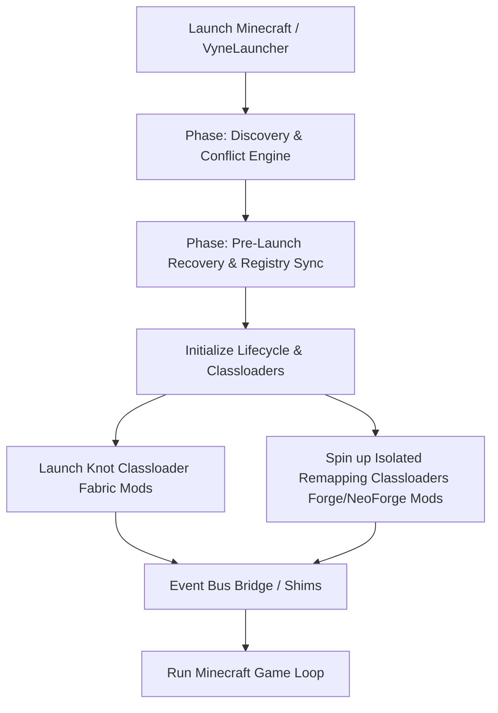
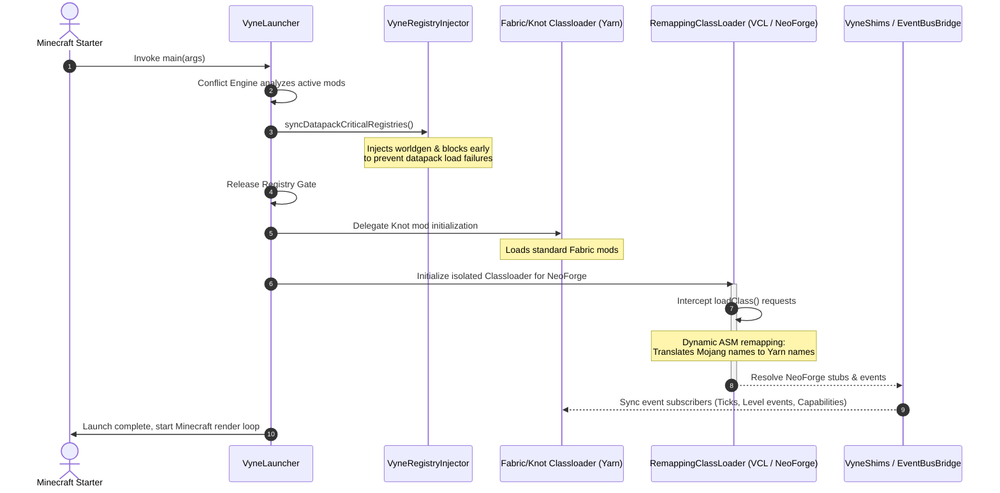

# How Vyne Works: Architecture & Lifecycle

> **⚠ Status note (unified Knot migration).** The diagrams below describe the *original* design, in which Forge/NeoForge mods run in an isolated `RemappingClassLoader` (VCL). The project has decided on a **unified Knot** architecture (see the "Decision" section in `unified-knot.md`): all mods mount onto the primary `KnotClassLoader`, and Forge/NeoForge bytecode is translated at the Knot entry point. The VCL is currently **transitional** — it is still used to bootstrap registry population until the `VyneTransformationGate` (`tasks.md` 2.2/2.3) handles the full translation cycle, then it will be removed. Read this document with that in mind; it will be rewritten against the real boot sequence once the gate lands.

This document explains the internal execution flow of the Vyne Modloader, visualizing how it bridges Fabric/Knot and Forge/NeoForge ecosystems at runtime.

---

## 1. High-Level Architecture Flow

---

## 2. Startup & Boot Sequence (Sequence Diagram)

Below is the step-by-step startup process, showcasing classloader isolation and dynamic bytecode translation.

---

## 3. Core Subsystems

### A. Conflict Engine & Mod Discovery
Vyne scans the `/mods` directory and discovers both Fabric and Forge/NeoForge metadata. The `ConflictEngine` identifies incompatibilities (e.g. mixin collisions, dependency conflicts) and resolves which mods should run.

### B. Pre-Launch Registry Sync
One of Minecraft's biggest launch bottlenecks is worldgen registration. Fabric and NeoForge register worldgen features differently. Vyne proactively sweeps and triggers registry events during the `PRE-LAUNCH` phase using synthetic `RegisterEvent` shims. This ensures Minecraft's internal data registries are fully populated before the datapack engine boots.

### C. Classloader Isolation & Runtime Remapper
- **Knot Classloader**: Loads vanilla Minecraft and Fabric mods using Yarn mappings.
- **Remapping Classloader (VCL)**: Loads Forge/NeoForge mods. As a NeoForge mod class is read from its jar, the remapper interceptor transforms the bytecode, rewriting the references to match Yarn mappings so it can interact with the rest of the game seamlessly.
- **Bridges & Shims**: Bridges (like `VyneEventBus` and `VyneShims`) act as translator portals. When a NeoForge mod fires a custom event or registry call, the shim translates it and routes it into Fabric's game flow.
