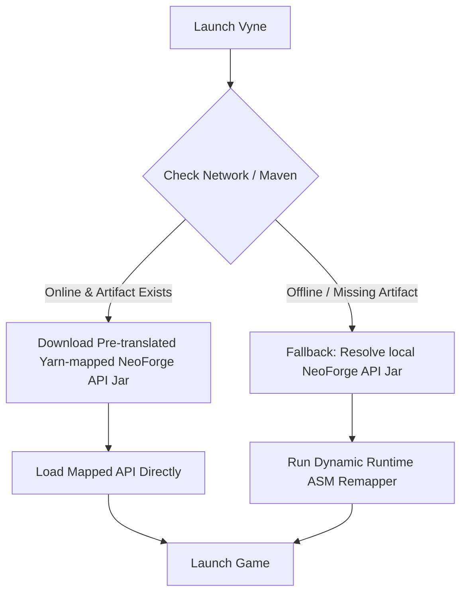

# Proposal: Pre-translated NeoForge API via Maven

## Objective
To improve Vyne's startup performance and classloader reliability by offloading the translation of the NeoForge API jar from runtime (using Vyne's dynamic ASM remapper) to a build-time Gradle pipeline. The remapped API jar will be hosted on Vyne's Maven servers and resolved at launch, falling back to dynamic runtime remapping if offline or if the artifact is missing.

---

## Architecture & Workflow

### 1. Build-Time Pre-translation (Separate Gradle Project)
A dedicated Gradle pipeline will be created to:
- Download specified NeoForge API versions.
- Run a tool like **Tiny Remapper** using the target Minecraft version's Yarn/Intermediary mappings to statically translate the entire API jar from Mojang/Official mappings to Intermediary mappings.
- Publish the translated jar to Vyne's Maven repository (e.g., as `dev.stolym.vyne:neoforge-api-yarn:<version>`).

### 2. Runtime Resolution & Fallback (Vyne Modloader)
At startup:
- Vyne's dependency resolver will attempt to fetch the remapped `neoforge-api-yarn` artifact from the Maven server.
- If successful, it loads the Yarn-mapped NeoForge classes directly.
- If offline, or if the server returns a 404 (e.g., for a brand new NeoForge version that hasn't been pre-translated yet), it falls back to download/use the standard NeoForge API jar and remaps it on the fly using Vyne's runtime remapping engine.

---

## Tasks & Implementation Plan

- [ ] **Phase 1: Finish the Runtime Remapping Engine**
  - Fully implement and stabilize `RemappingClassLoader` and `VyneRemapper`.
  - Ensure all edge cases (class verification, dynamic bridges) are handled.
- [ ] **Phase 2: Create the Pre-translation Gradle Tool**
  - Initialize a lightweight Gradle project dedicated to static mapping translation.
  - Configure **Tiny Remapper** to consume NeoForge jars and output Intermediary-mapped jars.
  - Setup publishing to the Maven repository.
- [ ] **Phase 3: Integrate Resolver into Vyne**
  - Add download logic to Vyne's bootstrap sequence.
  - Add signature verification and caching for the downloaded Yarn-mapped jars.
  - Connect the runtime remapper as the transparent fallback path.
